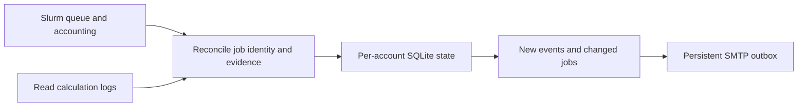

# AtomHPCMonitor

**Read-only Gaussian 16 and VASP monitoring for Slurm, with email updates that report only new progress.**

[English](README.md) · [简体中文](README.zh-CN.md) · [Configuration](docs/configuration.md) · [MIT license](LICENSE)


Long calculations should not require an open terminal. AtomHPCMonitor discovers your jobs, reconciles Slurm records with calculation logs, and sends completion notifications and scheduled progress emails. Its SQLite state survives restarts, so a previously reported result does not keep appearing in later emails.

## Features

- **Gaussian 16 and VASP discovery:** identify common submission scripts and supported input types; no manual Job ID list is needed for routine jobs.
- **Evidence-based results:** distinguish scheduler completion, program termination, and the registered convergence goal.
- **Incremental reporting:** include only new jobs or changed progress; completion notifications and scheduled reports share a per-job notification history.
- **Useful progress:** Gaussian stage, optimization step, SCF energy/cycles, convergence tables and frequencies; VASP ionic/electronic iterations and TOTEN.
- **Slurm context:** Job ID, partition, job name, user, state, elapsed time, nodes, and pending reason.
- **Durable email:** plain text plus restrained, paper-inspired HTML; accepted/failed/unknown delivery states and retries for explicit failures.
- **Editable schedules:** inclusive date range, multiple daily 24-hour times, and a fixed UTC offset. Default example: 07:30, 13:00 and 21:30 at UTC+08:00.
- **Safe history:** bounded recent-history discovery and terminal snapshots that preserve earlier results when log paths are reused.



The monitor reads calculation files. It does not edit inputs, cancel jobs, repair calculations, or resubmit work. It runs as an independent Python process and does not need an AI API.

## Requirements

- Python **3.7 or newer**; runtime dependencies are entirely from the standard library.
- A Slurm environment with `squeue`, `sacct`, and `scontrol`, and access to your calculation directories.
- An SMTP server supporting SSL/TLS on connect (`SMTP_SSL`) if email is enabled.
- A cluster-approved place to run the monitor, with a state directory that supports SQLite and file locking.

Live commands must run under the same operating-system username as the selected account. CLI messages and email text currently use Chinese; this guide explains the workflow in English.

## Quick start

```bash
git clone https://github.com/AtomRearch/AtomHPCMonitor.git
cd AtomHPCMonitor
cp config.example.json config.local.json
```

Edit `config.local.json`: replace the example account `hpc_user` with your actual Slurm login in `accounts`, `auto_discovery.accounts`, and `reports.accounts`. The optional `gaussian_user` profile demonstrates a second account restricted to Gaussian; remove it or customize it for a separate login session.

Run these commands on your cluster, under your own account:

```bash
python3 -m atomhpcmonitor --config config.local.json --account "$(id -un)" doctor
python3 -m atomhpcmonitor --config config.local.json --account "$(id -un)" poll --discover all --history-hours 24 --dry-run
```

`--dry-run` previews discovery and observations without saving job observations or sending mail. Opening a new state database may still initialize its schema.

### Configure email

```bash
cp smtp.example.json smtp.local.json
chmod 600 config.local.json smtp.local.json
```

Edit `smtp.local.json` with your sender, SMTP app password, and receiver. Set the provider's `smtp.host` and `smtp.port` in `config.local.json`. `smtp.example.com` is a placeholder. Enable `smtp.enabled` when ready.

```bash
# Login check only; this does not send email.
python3 -m atomhpcmonitor --config config.local.json --account "$(id -un)" doctor --smtp

# Explicitly send one full report to verify delivery and layout.
python3 -m atomhpcmonitor --config config.local.json --account "$(id -un)" report --program all --send
```

SMTP acceptance records the server response, not inbox receipt. Automatic delivery can also send previously queued notifications; inspect `outbox` before enabling it on an existing state database. `report --send` sends only the explicitly requested report.

### Scheduled progress reports

Edit the `reports` section with your desired dates, `times`, and `timezone`, then set `enabled` to `true`. Keep `only_on_change: true` for incremental reports.

```json
{
  "enabled": true,
  "accounts": ["hpc_user"],
  "programs": ["g16", "vasp"],
  "start_date": "2026-01-01",
  "end_date": "2026-12-31",
  "times": ["07:30", "13:00", "21:30"],
  "timezone": "UTC+08:00",
  "only_on_change": true,
  "catch_up_minutes": 60
}
```

At each scheduled slot, only newly observed jobs or changes in state, steps, energy, stage, or convergence are included. Unchanged running jobs and previously reported terminal results are omitted. Clock ticks, elapsed-time growth, and log timestamps alone do not trigger a report. Completion/failure notifications are independent of the daily report times and share the same job history.

If a first report has no prior notification history, it establishes a baseline. Pending automatic mail retains its snapshot while retrying. A report contains at most 100 changed jobs; additional unreported changes remain eligible for a later slot. Manual `report` remains a full overview.

### Run continuously

Start **one monitor per account/state database** in your site's approved monitoring location:

```bash
mkdir -p logs
nohup python3 -u -m atomhpcmonitor --config config.local.json --account "$(id -un)" run --discover all --history-hours 24 > "logs/monitor-$(id -un).log" 2>&1 < /dev/null &
echo $! > "logs/monitor-$(id -un).pid"
```

`run` emits a compact summary every cycle; the default polling interval is 300 seconds. Use `run --json` for full observations. Inspect the process on the host where it was started:

```bash
ps -p "$(cat "logs/monitor-$(id -un).pid")" -o pid,etime,args
tail -n 5 "logs/monitor-$(id -un).log"
```

Stop the existing monitor before starting a replacement. Configuration changes take effect after restart. Keep the private configuration and `runtime/` during upgrades.

## Interpreting results

| Status | Meaning |
|---|---|
| ⏳ `RUNNING` / 🕓 `PENDING` | Slurm still reports an active or waiting job. |
| 📝 `FINALIZING` | Waiting for final evidence, log stabilization, or incremental log catch-up. |
| ✅ `SUCCEEDED` | Scheduler, program termination, and registered goal checks pass. |
| ⚠️ `GOAL_NOT_REACHED` | The calculation ended but the registered convergence goal was not confirmed. |
| ❌ `PROGRAM_FAILED` / `SLURM_FAILED` | Program error evidence or scheduler/exit-code failure. |
| ⌛ `TIMEOUT`, 🧠 `OUT_OF_MEMORY`, ⏹️ `CANCELLED` | The corresponding Slurm outcome. |
| 🔎 `NEEDS_REVIEW` / ❔ `INSUFFICIENT` | Evidence requires review or is not sufficient for a stronger conclusion. |

A job disappearing from `squeue` is not treated as success. Likewise, a normal VASP timing footer does not establish ionic convergence. Iteration counts are observations, not a completion percentage or a substitute for scientific validation.

Recent-history imports are limited by the configured window, identity checks, accessible scripts/inputs, and log timestamps. Ambiguous mappings are skipped. A historical import enters reports without replaying a backlog of individual completion alerts.

## Other commands and limitations

`discover`, `status`, `events`, and `outbox` expose discovery, saved state, evidence, and delivery history. `add` / `import-jobs` support explicit mappings, `rebind` requires human confirmation of a restarted/requeued job, and `retry-mail` handles operator-directed retries. See the [configuration and command guide](docs/configuration.md).

Supported targets are Gaussian `sp`, `opt`, `freq`, `opt_freq`, and ordinary self-consistent VASP `sp` / `relax`. Multi-Link1 auto-discovery, complex wrappers/redirections, and specialized VASP tasks such as NEB, MD, non-SCF DOS/bands, response, and GW require additional handling. VASP parameters with a single trailing parenthesized annotation are accepted where supported.

## Development and privacy

```bash
python -m unittest discover -s tests -v
python examples/demo.py --output outputs/demo
```

The demo uses synthetic jobs, verifies restart deduplication and unchanged input hashes, and does not contact Slurm or SMTP. The current suite has **134 tests**. A [synthetic HTML email preview](docs/email-preview.html) illustrates the template; generated local files are not publication assets.

This repository contains generic account names and synthetic fixtures. Keep credentials, state databases, real outputs, email diagnostics, and personal cluster configuration out of commits and public issues. Diagnostic exports contain paths and calculation excerpts even though SMTP credentials are excluded. See [SECURITY.md](SECURITY.md) and [CONTRIBUTING.md](CONTRIBUTING.md).

## License

[MIT](LICENSE). You may use, modify, and redistribute the software, including commercially, while retaining the copyright and license notice.
